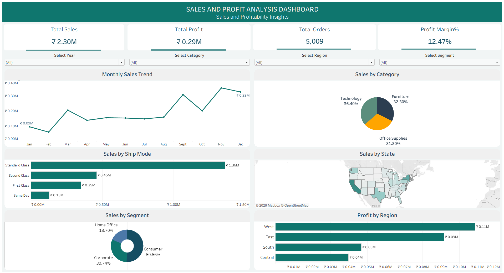
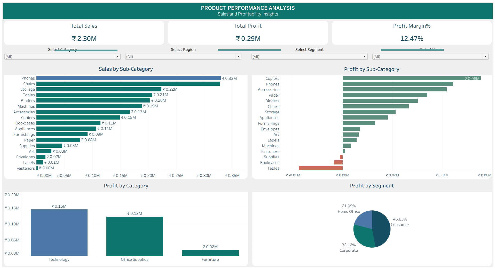

# Sales and Profit Analysis Dashboard – Tableau

An interactive Tableau portfolio project built using the Sample Superstore dataset to analyze retail sales, profitability, product performance, customer segments, shipping methods, and regional performance.

The project contains two interactive dashboards:

1. Sales and Profit Analysis Dashboard
2. Product Performance Analysis Dashboard

---

## 1. Project Overview

Retail businesses need to understand not only how much they sell but also where profit is generated and where losses may occur.

This project uses Tableau to transform retail order data into interactive dashboards that help analyze sales trends, profitability, product performance, customer segments, and regional performance.

## 2. Dashboard Previews

### Dashboard 1 – Sales and Profit Analysis

This dashboard provides an overview of business performance through KPIs, monthly sales trends, category performance, customer segments, shipping methods, and regional profitability.




### Dashboard 2 – Product Performance Analysis

This dashboard focuses on product-level performance, including sales by sub-category, profit by sub-category, profit by category, and profit contribution by customer segment.



---

## 3. Business Objectives

- Monitor overall sales, profit, order volume, and profit margin.
- Understand monthly sales trends.
- Compare sales across product categories and sub-categories.
- Identify profitable and loss-making sub-categories.
- Analyze sales and profit across customer segments.
- Evaluate sales performance by shipping method.
- Compare sales performance across states.
- Identify regional profitability.
- Enable interactive analysis using dashboard filters.

## 4. Dataset Information

**Dataset:** Sample Superstore

**Main Table:** Orders

The dataset contains the following fields:

| Category | Fields |
|---|---|
| Order Information | Row ID, Order ID, Order Date, Ship Date, Ship Mode |
| Customer Information | Customer ID, Customer Name, Segment |
| Location | Country, City, State, Postal Code, Region |
| Product Information | Product ID, Category, Sub-Category, Product Name |
| Measures | Sales, Quantity, Discount, Profit |

## 5. Tools and Technologies

- **Tableau Desktop** – Data visualization and interactive dashboard development.
- **Microsoft Excel** – Original dataset.
- **Tableau Packaged Workbook (.twbx)** – Workbook containing packaged supporting data.

## 6. Dashboard 1 – Sales and Profit Analysis

This dashboard provides an overall view of business performance.

### Key Performance Indicators (KPIs)

| KPI | Description |
|---|---|
| Total Sales | Total sales revenue generated. |
| Total Profit | Total profit generated. |
| Total Orders | Number of distinct orders. |
| Profit Margin | Percentage of sales retained as profit. |

**Profit Margin Formula:**

```text
Profit Margin = SUM(Profit) / SUM(Sales)
```

### Visualizations

| Chart | Purpose |
|---|---|
| Monthly Sales Trend | Analyzes monthly sales performance. |
| Sales by Category | Compares sales across product categories. |
| Sales by State | Shows geographic sales distribution. |
| Sales by Segment | Compares sales across customer segments. |
| Sales by Ship Mode | Analyzes sales by shipping method. |
| Profit by Region | Compares profitability across regions. |

### Dashboard Filters

- Order Date
- Category
- Region
- Segment

These filters allow users to explore performance for selected periods, categories, regions, and customer segments.

## 7. Dashboard 2 – Product Performance Analysis

This dashboard focuses on product-level sales and profitability.

### Key Performance Indicators

- Total Sales
- Total Profit
- Profit Margin

### Visualizations

| Chart | Purpose |
|---|---|
| Sales by Sub-Category | Compares sales across product sub-categories. |
| Profit by Sub-Category | Identifies profitable and loss-making sub-categories. |
| Profit by Category | Compares profit across the three main product categories. |
| Profit by Segment | Shows each customer segment's contribution to total profit. |

### Dashboard Filters

- Order Date
- Category
- Region
- Segment

These filters allow users to perform focused product-performance analysis.

## 8. Calculated Fields

### Profit Margin

```text
SUM([Profit]) / SUM([Sales])
```

Calculates profit as a percentage of total sales.

### Sales Highlight

```text
IF [Sub-Category] = "Phones" THEN "Highlight"
ELSE "Other"
END
```

Separates Phones from the other sub-categories for visual emphasis.

### Category Highlight

```text
IF [Category] = "Technology" THEN "Highlight"
ELSE "Other"
END
```

Separates Technology from the other categories for visual emphasis.

### Donut Placeholder

```text
1
```

A constant value used in the donut-chart construction.

## 9. Dashboard Design and Color Theme

A consistent professional color palette is used across both dashboards.

| Color | Hex Code | Usage |
|---|---|---|
| Dark Navy | `#2C3E50` | Titles and primary chart elements |
| Orange | `#FFA500` | Highlights and accents |
| Light Grey | `#F0F0F0` | Dashboard background |
| Muted Blue | `#5B8FA8` | Supporting visual elements |
| Muted Green | `#5B8E7D` | Positive profit emphasis |
| Muted Red | `#C96B5B` | Negative profit emphasis |
| Pale Blue | `#DCE6ED` | Supporting visual elements |

The dashboards use consistent typography, readable labels, white chart areas, and a restrained color scheme to provide a clean and professional appearance.

## 10. How to Use the Dashboard

1. Download or clone this GitHub repository.
2. Open the Tableau packaged workbook (`.twbx`) using Tableau Desktop.
3. Navigate between the two dashboards.
4. Use the available filters to select the required date range, category, region, or segment.
5. Review the KPI values and visualizations.
6. Hover over chart elements to view additional details through tooltips.
7. Change or clear filters to explore different business scenarios.

**Note:** If Tableau requests the original data source, reconnect the workbook to your Sample Superstore Excel dataset or use the packaged extract where available.

## 11. Key Business Questions

This project helps answer questions such as:

- How do sales change month by month?
- Which product category generates the highest sales?
- Which sub-categories generate the highest profit?
- Which sub-categories experience losses?
- Which customer segment contributes the most profit?
- Which shipping method accounts for the highest sales?
- How does sales performance vary across states?
- Which region generates the highest profit?

Dashboard filters can be used to investigate these questions for different selections.

## 12. GitHub Repository Structure

```text
Sales-and-Profit-Analysis-Tableau/
│
├── README.md
│
├── Sales and Profit Analysis Dashboard.twbx
│
├── Dataset/
│   └── sample_superstore.xlsx
│
└── Screenshots/
    ├── Sales-Profit-Dashboard.png
    └── Product-Performance-Dashboard.png
'''

**Screenshot paths used in this README:**

- `Screenshots/Sales-Profit-Dashboard.png`
- `Screenshots/Product-Performance-Dashboard.png`

Upload both PNG files into a folder named `Screenshots` in the root of your GitHub repository. The filenames and folder name must match these paths exactly (including capitalization) for GitHub to display the images.

## 13. Skills Demonstrated

- Data visualization using Tableau
- Data exploration and analysis
- KPI development
- Calculated fields
- Interactive dashboard development
- Sales and profitability analysis
- Time-series analysis
- Product performance analysis
- Customer segment analysis
- Dashboard filtering and formatting
- Business insights and data storytelling

## 14. Future Improvements

- Add year-over-year sales and profit comparisons.
- Include more detailed customer-level analysis.
- Add shipping and delivery performance metrics.
- Implement additional drill-down interactions.
- Add explanatory annotations and advanced tooltips.
- Publish dashboards to Tableau Public, subject to data-sharing permissions.

## 15. Project Status

**Completed**

The project includes two Tableau dashboards:

1. Sales and Profit Analysis Dashboard
2. Product Performance Analysis Dashboard

---

## Author

**Tatini Raghu Ram**  
B.Tech – Computer Science & Engineering  
Aspiring Data Analyst

**Skills:** Excel | SQL (MySQL) | Python | Power BI | Tableau | Analytics

**Connect with me:**
- [LinkedIn](https://www.linkedin.com/in/raghuramtatini/)
- [GitHub](https://github.com/Raghu200596)

---

**Project Category:** Data Analytics Portfolio Project  
**Tools:** Tableau | Microsoft Excel  
**Dataset:** Sample Superstore
